# context-meter

A small Claude Code plugin that keeps an eye on your context window for you.

I kept running into the same thing: a long session goes great, then suddenly Claude compacts the conversation and I had no idea it was coming. So I made a little meter that sits right above the message box and shows how full things are, how much the last reply added, where my plan limits are, and what the session has cost so far.

<p align="center">
  
</p>

## Two ways to see it

**The band** is one quiet line above the prompt. It stays grey and out of the way, and only turns amber at 70% and red at 85%. The little tick on the bar marks where auto-compact kicks in, and `+26k last reply` tells you which message ate the most space.

**The side panel** is for when you want the whole picture:



- How full the context is, with a rough guess at **how many replies you have left** before compaction, based on your recent pace
- A chart of how the context grew over the session
- What's actually taking up the space: your messages, tools, memory files and so on
- Your 5-hour and weekly plan limits, with when they reset
- What the session has cost

You can show the band, the panel, or both, and switch whenever you like. It remembers your choice next time.

On the desktop app, VS Code and mobile it draws proper graphics. In the terminal it falls back to simple text bars.

<br clear="right">

## Install

In a Claude Code terminal session, run:

```
/plugin install context-meter --marketplace nocashflow/context-meter
```

Say `y` when it asks to add the marketplace, then pick a scope. The user scope means it loads in every session.

Prefer the shell?

```bash
claude plugin install context-meter --marketplace nocashflow/context-meter
```

In the Claude desktop app, click **+** next to the prompt box, go to **Plugins**, choose **Add marketplace**, enter `nocashflow/context-meter`, then **Add plugin**.

## Using it

| Command | What happens |
| --- | --- |
| `/context-view` | Flips between the band and the panel |
| `/context-view band` | Just the band |
| `/context-view pane` | Just the side panel |
| `/context-view both` | Both at once |
| `/context-view off` | Hides everything |

The buttons in the band and the panel do the same thing. If you close the panel yourself, it falls back to the band.

## What it can and can't see

context-meter only reads your session's own usage numbers, the same ones `/context` and `/cost` show you. The breakdown is worked out locally, so it doesn't send any extra requests. It has no access to your files, your terminal or the network, it never reads your messages, and the only thing it saves is which view you picked.

## A small confession

I mostly built this to learn git and GitHub properly. This is my first public repo, my first real commit history and my first README, and my first time writing TypeScript with JSX too. So if you spot something odd, or there's a better way to do any of it, please [open an issue](https://github.com/nocashflow/context-meter/issues). I'd genuinely like to learn from it.

## Working on it

If you want to poke at the code:

```bash
claude plugin validate .
claude plugin test .
```

And to run your local copy while you change things:

```bash
claude --plugin-dir .
```

*The images above are illustrations made for this README. The real thing follows your app's theme.*

## License

[MIT](LICENSE). Use it, change it, share it.
